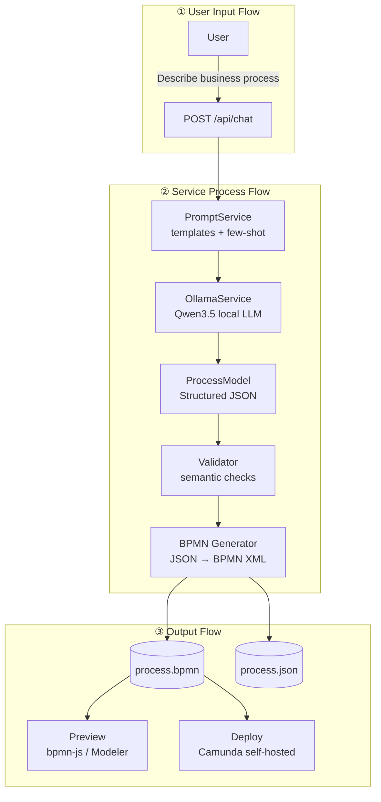

# FXV BPMN Studio (`flex-bpmn`)

GitHub-ready package of the BPMN studio (source only — no `.venv`, `node_modules`, or secrets).

**FXV BPMN Studio** turns **custom business requirements** into Camunda-ready BPMN 2.0 diagrams (`MODEL` namespace, DI layout, **swimlanes**, Zeebe user/service tasks). Describe any process in natural language, review the generated JSON, then draw and deploy. The bundled **LMS & Exam PRD** (`docs/PRD-LMS-EXAM.md`, `examples/lms_*.json`) is a **reference domain and regression test suite** — not the only supported product.

**Setup:** copy `backend/.env.example` → `backend/.env` (and optionally `frontend/.env.example` → `frontend/.env`). Keep API keys out of git.

| Path | When | Flow |
|------|------|------|
| **Custom / dynamic** | You describe your own process (any domain) | Provider → `POST /api/chat` → review JSON → `POST /api/generate-bpmn` → deploy |
| **Catalog / example** | PRD or golden JSON (incl. LMS/Exam P1–P5) | `GET /api/catalog/{id}` → validator → generator → diagram (no LLM) |

Custom prompts can model **any** actor set — e.g. **candidate**, **employer**, **regulator**, **trainer**, **job post** approval, or **skills training** flows. Swimlanes and `candidateGroups` are generated from the lanes the LLM (or you) define in JSON, not limited to LMS roles.

---

## 📊 Overview — Block Diagram

```
                         ┌─────────────────────────────────────────────┐
                         │              FXV BPMN STUDIO                │
                         │  Natural Language  →  Valid BPMN 2.0 File   │
                         └─────────────────────────────────────────────┘


  ╔══════════════════════════════════════════════════════════════╗
  ║                    ① USER INPUT FLOW                         ║
  ╚══════════════════════════════════════════════════════════════╝
        [ User ] ── types business prompt ──► [ POST /api/chat ]

            "Create an employee onboarding workflow."


  ╔══════════════════════════════════════════════════════════════╗
  ║                  ② SERVICE PROCESS FLOW                      ║
  ╚══════════════════════════════════════════════════════════════╝

     ┌───────────────┐    ┌───────────────┐    ┌──────────────────┐
     │  PromptService │──►│ OllamaService │──►│   ProcessModel   │
     │  (templates +  │    │  (Qwen3.5 LLM)│    │   (JSON schema) │
     │   few-shot)    │    │  parse JSON   │    │                  │
     └───────────────┘    └───────────────┘    └────────┬─────────┘
                                                        │
                                          ┌─────────────▼─────────────┐
                                          │  Validator (semantic)     │
                                          │  start/end check, dup IDs,│
                                          │  orphan nodes, broken     │
                                          │  sequence flows            │
                                          └─────────────┬─────────────┘
                                                        │
                                          ┌─────────────▼─────────────┐
                                          │ BPMN Generator           │
                                          │  JSON → BPMN XML (lxml)   │
                                          └─────────────┬─────────────┘


  ╔══════════════════════════════════════════════════════════════╗
  ║                     ③ OUTPUT FLOW                            ║
  ╚══════════════════════════════════════════════════════════════╝
        [ process.bpmn ]  [ process.json ]
              │                 │
              ▼                 ▼
        [ Download ]      [ bpmn-js / Modeler preview ]
              │
              ▼
      [ Deploy to Camunda 8 ]   (optional, self-managed :8080)
```

### Mermaid diagram (renders on GitHub / VS Code preview)



---

## Repo Layout

```
fxv-bpmn/
├── backend/                 # FastAPI
│   ├── app/
│   │   ├── api/             # chat, bpmn routes
│   │   ├── services/        # prompt, ollama, workflow, bpmn, validator
│   │   ├── schemas/         # Pydantic request/response/process model
│   │   ├── utils/           # logger, xml helpers
│   │   └── generated/       # output .bpmn / .json
│   ├── prompts/             # version-controlled LLM prompt templates
│   └── .env
├── frontend/                # React + Vite (scaffold)
├── examples/                # few-shot JSON/BPMN pairs
├── docs/
└── README.md
```

---

## Local development — startup sequence

Start services **in this order**. Ollama and API keys are assumed to be configured already (`backend/.env` copied from `.env.example`).

### 1. Camunda 8 Run (c8run) — port **8080**

```powershell
cd C:\Camunda\c8run-8.9.6
set JAVA_OPTS=-Xmx4g
.\c8run.exe start
```

**Validate c8run is up** before continuing:

| Check | URL / command |
|-------|----------------|
| Operate UI | http://localhost:8080/operate (login `demo` / `demo`) |
| Deploy REST API | http://localhost:8080/v2/deployments (POST only; GET may 405) |
| Health | `curl http://localhost:8080/v2/topology` returns cluster info |

Keep this terminal open — c8run must stay running while you deploy or execute processes.

### 2. Camunda Desktop Modeler (optional review)

Desktop Modeler is a **separate desktop app** (not served on port 8080). Use it to open downloaded `.bpmn` files for manual edits.

1. Launch **Camunda Desktop Modeler**.
2. **Connections → New → Camunda 8 Self-Managed**.
3. **Cluster URL**: `http://localhost:8080/v2`
4. **Authentication**: `None` (local c8run).

Port **8080** is the c8run web stack (Operate, Tasklist, Admin, REST API). Modeler connects to that cluster URL.

### 3. Backend API — port **9090**

```powershell
cd C:\Users\ASUS.LAPTOP-KBC03375\Documents\Flexavior\BPMN\fxv-bpmn
.venv\Scripts\activate
```

Ensure `backend/.env` includes:

```env
CAMUNDA_BASE_URL=http://127.0.0.1:8080
CAMUNDA_DEPLOY_ENABLED=true
OLLAMA_URL=http://127.0.0.1:11434
```

```powershell
uvicorn app.main:app --app-dir backend --reload --port 9090
```

Validate: http://127.0.0.1:9090/healthz → `{"status":"ok"}`

### 4. Frontend — port **5173**

```powershell
cd frontend
npm install    # first time only
npm run dev
```

Open http://localhost:5173 → select a PRD process → **Deploy to Camunda**.

Deploy feedback appears **below the diagram toolbar** and in the chat panel. If deploy fails, check that steps 1 and 3 completed and `CAMUNDA_DEPLOY_ENABLED=true`.

---

## Quick Start (backend only)

```bash
# 1. Setup (Windows)
python -m venv .venv
.venv\Scripts\activate
python -m pip install --upgrade pip
pip install -r backend/requirements.txt   # from project root

# 2. Ensure Ollama is running with qwen3.5
ollama pull qwen3.5:9b
ollama serve

# 3. Run backend — pick ONE option below. Do NOT combine them.

#    Option A — from the project root (fxv-bpmn/) — REQUIRES --app-dir backend:
uvicorn app.main:app --app-dir backend --reload --port 9090

#    Option B — cd into backend first, then NO --app-dir flag:
cd backend
uvicorn app.main:app --reload --port 9090
```

> ⚠️ **The two options are mutually exclusive.**
>
> - `--app-dir backend` tells uvicorn to look for `app` relative to the **root**
>   (`fxv-bpmn/`). Use it **only** when you run from the project root.
> - If you are **already inside `backend/`** (your prompt shows
>   `...\fxv-bpmn\backend>`), do **NOT** pass `--app-dir backend` — that makes uvicorn
>   look in the non-existent `backend\backend`, producing
>   `ModuleNotFoundError: No module named 'app'`. Just run
>   `uvicorn app.main:app --reload --port 9090` with no `--app-dir`.
>
> **Quick rule:** *inside `backend/` → no `--app-dir`; at the root → with `--app-dir backend`.*

### Endpoints

| Method | Path | Purpose |
|--------|------|---------|
| `GET`  | `/healthz` `/readyz` | Deploy probes |
| `GET`  | `/api/catalog`       | Catalog of proven example processes (includes LMS/Exam PRD) |
| `GET`  | `/api/catalog/{id}`  | Proven PRD JSON + BPMN diagram |
| `GET`  | `/api/providers`     | Safe provider availability + accessible models |
| `POST` | `/api/chat`          | Natural language → reviewable ProcessModel JSON + validation |
| `POST` | `/api/generate-bpmn` | JSON → BPMN XML |
| `POST` | `/api/validate`      | Semantic validation |
| `POST` | `/api/deploy`        | Camunda 8 deploy (off unless `CAMUNDA_DEPLOY_ENABLED=true`) |

## Example domain: LMS & Exam (teacher, student, admin)

The five processes in `docs/prd_catalog.json` are **golden examples** used by tests and the studio catalog — not the product itself.

| ID | Example process |
|----|-----------------|
| `lms_student_enrollment` | P1: Student course enrollment |
| `lms_exam_authoring` | P2: Teacher exam authoring and publish |
| `lms_exam_attempt` | P3: Student exam attempt and grading |
| `lms_admin_provisioning` | P4: Admin user provisioning |
| `lms_exam_appeal` | P5: Exam incident and appeal |

PRD: `docs/PRD-LMS-EXAM.md`. Tests: `cd backend && pytest`. Render PRD BPMN: `python backend/scripts/render_prd.py`.

FastAPI interactive docs at `http://127.0.0.1:9090/docs`.

---

## 🖥️ Frontend (React + Vite) — run & connect to the backend

The React/Vite frontend lets users select a live Ollama or configured remote
provider, generate process JSON, review validator output, and explicitly draw BPMN.

### Frontend prerequisites

| Tool | Purpose |
|------|---------|
| **Node.js 18+** + npm | Run the Vite dev server |
| Backend running on `http://127.0.0.1:9090` | The frontend talks to it via HTTP |
| **Ollama** (`qwen3.5:9b`) | Required only for `/api/chat` (the LLM step) |

### Start it

```bash
# 1. Start the backend first — from the PROJECT ROOT (fxv-bpmn/) so the
#    --app-dir backend flag works (see Quick Start above):
uvicorn app.main:app --app-dir backend --reload --port 9090

# 2. Install frontend deps and run the dev server (from project root):
cd frontend
npm install          # first time only
npm run dev          # serves at http://localhost:5173
```

Open `http://localhost:5173`, select an available provider/model, type a process
description, and press **Generate process JSON**. Review validation, then press
**Draw diagram**.

### How the frontend connects

- The frontend calls the backend directly at `http://127.0.0.1:9090` (endpoints in the
  table above). CORS is enabled on the backend so the browser is allowed through.
- To point at a different backend (e.g. a deployed instance), create `frontend/.env`
  with:
  ```env
  VITE_API_BASE=http://192.168.1.50:9090
  ```
- LLM flow: **provider check → `POST /api/chat` → JSON + validation → user review
  → `POST /api/generate-bpmn` → BPMNViewer**.
- Catalog flow remains **catalog JSON → validator → generator → BPMNViewer** with no LLM.
  Use the **Download .bpmn** button to save a file you can open in Camunda Desktop Modeler.

> ✅ The frontend was validated with `npm run build` (compiles to a static `dist/`).

---

## ⚙️ Camunda + BPMN Modeler — prerequisites & integration

This project's **output** is a standards-compliant BPMN 2.0 file. You can open it in
Camunda Desktop Modeler, deploy it to local **Camunda 8 Run** on port 8080, and operate
instances from the studio UI.

### What to install (prerequisites)

| Component | Version used | Why |
|-----------|--------------|-----|
| **Java** | OpenJDK 21 (LTS) | Required to run Camunda 8 / c8run |
| **Camunda 8 Run** (c8run) | v8.9.x | Local self-managed execution engine (**port 8080**) |
| **Camunda Desktop Modeler** | v5.x | Visual BPMN editing of generated files (desktop app) |
| **Ollama** | `qwen3.5:9b` (or any chat model) | Powers the LLM generation step (already running on `11434`) |
| **NoSQL / DB** | none needed yet | Postgres + pgvector planned for RAG (later phase) |

> Where to get them: Search *"Camunda 8 Run download"* and *"Camunda Desktop Modeler download"*
> on the Camunda docs site, unzip into `C:\Camunda\c8run-<version>`.

See **Local development — startup sequence** above for the ordered `c8run → modeler → backend → frontend` flow.

### c8run endpoints (port 8080)

- Web apps: Operate/Tasklist/Admin at `http://localhost:8080/operate`, `/tasklist`, `/admin`
- Login: **username `demo` / password `demo`**
- Cluster (deploy) API: `http://localhost:8080/v2`
- Zeebe gRPC: `http://localhost:26500`

### How it integrates with FXV BPMN Studio

```text
Describe process ──► [ /api/chat ] ──► LLM ──► JSON + validation ──► review
        │
        ▼
  [ /api/generate-bpmn ] ──► process.bpmn ──► bpmn-js preview
        │
        ├──► open in Desktop Modeler (optional tweak)
        │
        └──► [ /api/deploy ] ──► Camunda 8 Run :8080 ──► Operate / Tasklist
```

- **`POST /api/deploy`** uploads BPMN to `http://localhost:8080/v2/deployments` when `CAMUNDA_DEPLOY_ENABLED=true`.
- Deploy errors are shown inline below the diagram toolbar (not only in the sidebar).

### Troubleshooting

| Symptom | Fix |
|---------|-----|
| **Deploy to Camunda — nothing visible** | After this fix, errors appear below the diagram. Check chat panel too. |
| Deploy → **503** "Camunda deploy is disabled" | Set `CAMUNDA_DEPLOY_ENABLED=true` in `backend/.env` and restart uvicorn |
| Deploy → **503** "Cannot reach Camunda" | Start c8run first (`.\c8run.exe start`); validate http://localhost:8080/operate |
| Deploy → **4xx** from Camunda | Open Operate; check BPMN is executable; retry after fixing validation issues |
| `ModuleNotFoundError: No module named 'app'` | Start uvicorn with `--app-dir backend` (see Quick Start) |
| Frontend shows CORS / connection errors | Backend must be running on `127.0.0.1:9090`; check `VITE_API_BASE` |
| `localhost:8080` refused | Start `c8run.exe` and keep it running |
| `POST /api/chat` → **`503`** "Cannot reach Ollama…" | **Ollama isn't running.** Start it with `ollama serve` in another terminal, or `ollama run qwen3.5:9b` in the foreground |
| `POST /api/chat` → **`503`** "Ollama did not answer within 600s…" | **Model is still loading / generation too slow.** The first call after starting Ollama loads the ~6.6 GB model into memory and can take several minutes. Pre-load it once with `ollama run qwen3.5:9b` (then Ctrl+D), and retry |
| `POST /api/chat` → **`502`** "Model '…' was not found" | Pull the model first: `ollama pull qwen3.5:9b` |
| `POST /api/chat` → **`422`** invalid JSON | The model returned malformed output; retry, or use a smaller/faster model to reduce generation time |

> Backend now returns clean HTTP status codes with human-readable messages:
> `503` = Ollama unavailable or timed out, `502` = Ollama returned an error,
> `422` = the produced process model failed validation. The frontend shows the
> message text directly.

> **Speed tip:** a 9B model on an iGPU/CPU is slow. For quicker iteration,
> set `OLLAMA_MODEL=qwen3:0.5b` or `tinyllama` in `backend/.env` for testing,
> then switch back to `qwen3.5:9b` for final renders.

---

*Living document — plan & progress tracked in `LONG_TERM_PLAN.md`.*